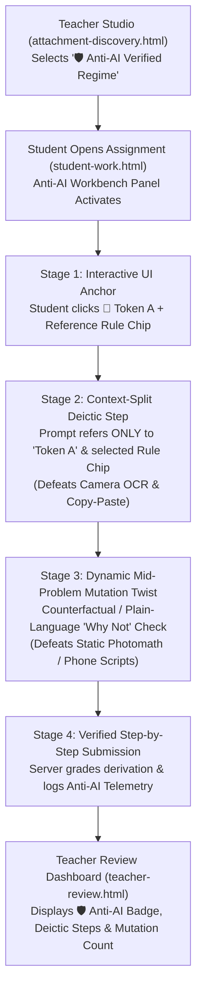

# Anti-AI Verified Workbench Methodology (`anti_ai_shield`)
**Timer-Free, Camera-Free Prevention of External AI Outsourcing in Socratic Student Dialogues**

---

## 1. Executive Summary & Design Philosophy

Traditional anti-cheating mechanisms in online education rely on either:
1. **Invasive Biometric Proctoring** (webcam eye/head-position tracking, room scans), which violates student privacy expectations (FERPA / PIPEDA) and creates anxiety.
2. **Countdown Timers**, which penalize students with accommodations (IEPs, ELL/ESL learners) or thoughtful paper-and-pencil problem solvers.
3. **Browser Tab Lockdowns**, which are completely ineffective when a student holds a secondary device (smartphone or tablet running ChatGPT, Claude, Photomath, or Symbolab) next to their screen.

The **Anti-AI Verified Workbench Methodology (`anti_ai_shield`)** in **SocratesAI** takes a fundamentally different approach: **Cognitive Friction Inversion & Context-Split Dialogic Design**.

Instead of trying to lock down the student's room or rush them with a clock, the dialogue and user interface are structured so that:
- **Camera/OCR solvers (Photomath, ChatGPT Vision) fail** because individual chat prompts never contain a self-contained mathematical equation and the problem mutates mid-solution.
- **Text/Voice LLMs on a second device become slower and harder to prompt than actually solving the micro-step**, because the student must first resolve visual UI references (`🔵 Token A`, `🟠 Token B`) and interactive rule chips that only exist inside the live workspace state.

---

## 2. Core Pillar 1: Deictic Context-Split Referencing (Defeating Camera OCR & Copy-Paste)

### The Vulnerability in Standard AI Tutors
In a conventional AI chat tutor, the assistant writes:
> *"What do you get when you apply the Power Law to $2\log_3(6)$ in $2\log_3(6) - \log_3(4)$?"*

A student can point a phone camera at that single chat bubble (or copy-paste the text into another browser window) and immediately receive the exact answer.

### The SocratesAI Mechanism
1. **Color-Coded Token Decomposition in the Workbench Header**:
   The active problem is parsed into clickable, color-coded visual tokens pinned in the **Anti-AI Workbench Panel**:
   - `🔵 Token A`: First algebraic term or given quantity (e.g., $2\log_3(6)$)
   - `🟠 Token B`: Second algebraic term or operator block (e.g., $-\log_3(4)$)
   - `🟣 Token C`: Target condition or boundary constraint
2. **Deictic-Only Chat Prompts**:
   The Socratic prompt inside the chat bubble **never repeats the raw mathematical formula**. Instead, it uses deictic pointers (`Token A`, `Token B`, *"the Rule Chip you just selected"*):
   > *"Apply your selected rule chip to **🔵 Token A** only. What new value ends up inside **🔵 Token A**?"*

### Why It Defeats Secondary Devices
- Taking a photo of the chat prompt or pasting it into ChatGPT yields an **incomplete, context-free sentence** (*"Apply your selected rule chip to Token A only..."*).
- To query an external AI on a phone, the student would have to mentally map `🔵 Token A` back to the expression, recall which rule chip they clicked in the UI, and manually type a synthesized prompt into their phone — which requires doing the exact cognitive work the Socratic step is teaching.

---

## 3. Core Pillar 2: Interactive Workbench Anchoring (UI Action Before Text)

### The Vulnerability in Standard AI Tutors
Standard chat boxes accept free-form text at any time, allowing a student to transcribe or paste a multi-line derivation generated by another LLM.

### The SocratesAI Mechanism
Before the student can send an intermediate step (`💬 Send Step`) or submit a final solution (`✅ Submit Answer`), they must perform a **two-part interactive UI anchor** in the Workbench:
1. **Step 1a (Target Token Selection)**: Click which specific token (`🔵 Token A`, `🟠 Token B`, or `🟣 Token C`) must be transformed first according to operational priority.
2. **Step 1b (Reference Rule Chip Selection)**: Click the exact domain rule from the Teacher Reference Sheet that governs that transformation (e.g., `Power Law (k·log_b(x) → log_b(x^k))`, `Quotient Law`, `Molar Mass Conversion`, `Chain Rule`, `Newton Second Law`).

### Why It Defeats Secondary Devices
- An external AI on a tablet or phone only outputs text; it cannot click UI tokens or match them to the teacher's custom reference chips on the student's screen.
- The student's UI selections (`[Anti-AI Workbench: Token=🔵 Token A, Rule=Power Law]`) are cryptographically bound to the chat turn sent to the Socratic engine.

---

## 4. Core Pillar 3: Cognitive Friction Inversion (Hyper-Atomic Micro-Steps)

### The Principle
A student reaches for a secondary AI when the **activation energy of solving the prompt** is higher than the **effort of typing/photographing the prompt into a phone**.

$$\text{If } \text{Effort}(\text{Explain Context to Phone AI}) > \text{Effort}(\text{Answer Micro-Step}), \text{ Student Solves Directly.}$$

### The SocratesAI Mechanism
In `anti_ai_shield` mode, SocratesAI decomposes each milestone into **hyper-atomic micro-questions** tied to the selected token:
1. *"In **🔵 Token A**, when the front multiplier climbs up as an exponent on the inner number, what is that power equal to?"* (Student answers `6^2 = 36`).
2. *"Now that **🔵 Token A** has $36$ inside and **🟠 Token B** has $4$ inside, what single number do we get when the Quotient Law divides them?"* (Student answers `9`).
3. *"What power of the base gives $9$?"* (Student answers `2`).

### Why It Defeats Secondary Devices
No student picks up a smartphone to ask ChatGPT what $6^2$ or $36 \div 4$ is. Yet by selecting the rule chips and answering the sequence of micro-steps, the student genuinely executes the entire derivation themselves.

---

## 5. Core Pillar 4: Dynamic Mid-Problem Mutation & "Faulty Classmate" Twist

### The Vulnerability in Standard AI Tutors
When a problem is static from start to finish, a student can scan the problem once with Photomath at the beginning of the session, get a 3-line solution script on their phone, and copy Line 1, Line 2, and Line 3 into the chat.

### The SocratesAI Mechanism
As soon as the student verifies Step 1 (`💬 Send Step`), the Anti-AI Workbench automatically unlocks **Stage 3: Live Mid-Problem Verification Twist (`#antiAiMutationTwistBox`)**:
- Before `✅ Submit Answer` is unlocked, the tutor injects a **live counterfactual or "Faulty Classmate" check** on the student's intermediate result:
  > *"🔄 **Live Mid-Problem Verification Twist:** Before finalizing, a classmate claims we can combine **🔵 Token A** and **🟠 Token B** by directly subtracting their inner raw numbers without applying your selected rule chip first. In 5–15 plain everyday words (no textbook jargon!), explain why that shortcut fails and write your combined step."*

### Why It Defeats Secondary Devices
- **Invalidates Static Solvers**: Because the verification twist asks a dialogic, counterfactual *"Why does this specific shortcut fail on Token A and Token B?"* question mid-flight, a static Photomath/Symbolab step list cannot answer it.
- **Anti-Jargon Voice Check**: Requiring a short, plain-English intuition check (5–15 everyday words) exposes formal copy-pasted LLM prose (*"By the properties of logarithmic functions..."*), prompting SocratesAI to ask the student to restate the idea in their own conversational words.

---

## 6. Core Pillar 5: Curriculum Grounding & Method-Drift Detection

### The Vulnerability in Standard AI Tutors
General-purpose LLMs solve math and science problems using whatever general method is most common in their training data — often using formulas or shortcuts **not taught in the teacher's current unit** (for example, converting base-3 logarithms to natural logs $\frac{\ln 36}{\ln 3}$ or decimal approximations, or using L'Hôpital's rule in an algebraic limits lesson).

### The SocratesAI Mechanism
- All Socratic prompts in `anti_ai_shield` mode are strictly grounded in the **Teacher's Loaded Reference Sheet & Curriculum Standard** (Block 1 Material Studio).
- If a student submits an answer using out-of-curriculum notation or an unassigned shortcut (**Method Drift**), SocratesAI rejects the shortcut even if the final number is mathematically true, requiring the student to derive the result using the specific law from the Teacher Reference Sheet.

---

## 7. Passive Behavioral & Authenticity Telemetry (Teacher Review Dashboard)

While no invasive camera or timer is ever used, the workspace passively records structural interaction telemetry in `antiAiTelemetry` for the teacher's **Cohort & Grading Dashboard** (`teacher-review.html`):

| Metric | Description | Pedagogical Meaning |
| :--- | :--- | :--- |
| **`tokenSelectionsCount`** | Number of Deictic Token anchors clicked in the Workbench | Confirms active visual decomposition of the problem |
| **`ruleSelectionsCount`** | Number of Reference Rule Chips matched to tokens | Confirms explicit rule identification before algebra |
| **`deicticStepsCompleted`** | Context-split intermediate steps verified via `💬 Send Step` | Confirms multi-turn reasoning rather than single-shot answer entry |
| **`mutationTwistsVerified`** | Mid-problem counterfactual / plain-language twists passed | Confirms conceptual resilience against static solver scripts |
| **`pasteEventsCount`** | Clipboard `paste` events into the math/chat input | Flags potential external text copying for teacher inspection |
| **`tabSwitchesCount`** | Browser `visibilitychange` (tab/window blur) count during session | Provides passive context alongside active time per problem |

---

## 8. End-to-End Student & Teacher Workflow Diagram

