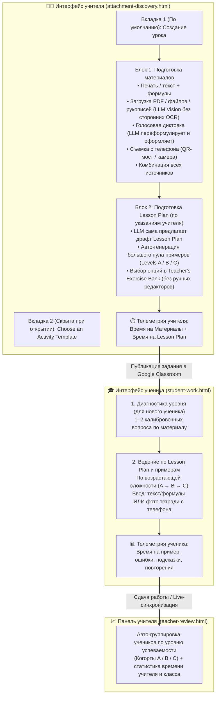

# Архитектура SocratesAI v2.0 (Material Studio, AI Lesson Plan, Adaptive Student Flow & Telemetry)

---

## Обзор изменений

Новая архитектура переводит подготовку урока учителем из ручного заполнения разрозненных полей в **двухшаговый AI-конвейер** (**Блок 1: Подготовка материалов** $\rightarrow$ **Блок 2: Генерация Lesson Plan и пула примеров**), упрощает интерфейс выбора уровней `A / B / C` (сохраняя существующий код редакторов в неактивном резерве), выносит готовые шаблоны в скрытую по умолчанию вкладку и вводит полную телеметрию как для **учеников** (с авто-группировкой по когортам), так и для **учителя** (трекинг времени на подготовку материалов и Lesson Plan).

---

## 1. Блок 1: Отдельный блок подготовки материалов (`Teacher Material Studio`)

При открытии аддона учитель сразу видит **Блок 1 — Подготовка учебных материалов и базовых примеров**. Учитель может использовать любой способ ввода отдельно или **комбинировать их в любом порядке**:

1. **Клавиатурный ввод (Печать):**
   - Ввод или вставка текста и базовых примеров (с поддержкой нашего живого форматирования формул).
2. **Подгрузка существующих материалов с базовыми примерами (включая рукописные материалы учителя):**
   - Источники: файлы с компьютера (`.pdf`, `.docx`, `.txt`, `.md`, изображения), материалы из Google Classroom Stream и Google Drive.
   - **Распознавание рукописей и сканов силами самой мультимодальной LLM (без сторонних OCR-библиотек):**
     - Страницы PDF или фото рукописных конспектов учителя отправляются напрямую в мультимодальную LLM (`Gemini Vision` / `Claude` / `GPT-4o`).
     - LLM считывает рукописный текст, формулы, схемы и базовые примеры учителя и преобразует их в чистый структурированный учебный конспект с математической разметкой `$LaTeX$`.
3. **Надиктовывание голосом с умным рерайтингом LLM (`Voice-to-Structured-Material`):**
   - Кнопка `🎤 Надиктовать материал`: учитель свободно говорит своими словами (например: *«Запиши тему: логарифмические уравнения. Напомни ученикам три свойства и добавь базовый пример: два логарифма по основанию три от шести минус логарифм по основанию три от четырёх...»*).
   - LLM принимает аудио/расшифровку речи и **сама переформулирует устную речь в грамотный учебный текст**, автоматически оформляя формулы, определения и базовые примеры.
4. **Съёмка телефоном (`📷 Снять с телефона`):**
   - Учитель может сфотографировать телефоном страницу бумажного задачника, свой рукописный листок или школьную доску (через QR-мост с экрана ноутбука или напрямую с камеры мобильного устройства).
   - Снимок сразу распознаётся мультимодальной LLM и добавляется в общий материал.
5. **Комбинация всех источников (`Unified Material Synthesis`):**
   - Все фрагменты (напечатанный текст + загруженный рукописный конспект + надиктованные голосом пояснения + фото примеров с телефона) собираются в едином окне **«Итоговый материал урока и базовые примеры»**, где LLM по кнопке `✨ Объединить и причесать материал` сводит их в цельный документ.

---

## 2. Блок 2: Подготовка `Lesson Plan` и расширенного пула примеров на основе материалов

Сразу под Блоком 1 располагается **Блок 2 — Подготовка Lesson Plan**:

1. **Указания учителя для Lesson Plan:**
   - Короткое поле (с поддержкой печати и голосовой диктовки `🎤`) + быстрые опции: на чём сфокусировать урок, какой стиль подсказок выбрать и сколько ступеней отработки заложить.
2. **Автоматический первичный драфт от LLM (`AI-First Lesson Plan Draft`):**
   - Как только материалы в Блоке 1 готовы (или по нажатию кнопки `✨ Сформировать драфт Lesson Plan`), **LLM сама генерирует полный драфт плана урока**, включающий:
     - Название задания (`Assignment Title`) и главную педагогическую цель (`Learning Goal`);
     - Пошаговый маршрут урока (`Lesson Steps / Specific Expectations`) — последовательность концептов, по которым ИИ будет вести ученика;
     - **Расширенный банк примеров (большое число задач)** по возрастающей сложности на основе базовых примеров из материалов учителя:
       - **Диагностические мини-вопросы (2–3 шт.)** для быстрой проверки начального уровня ученика;
       - **Пул Level A (Foundational — например, 4–6 примеров)** — базовые одношаговые задачи для отработки и повторений;
       - **Пул Level B (Proficient — например, 4–6 примеров)** — стандартные комбинированные задачи;
       - **Пул Level C (Advanced — например, 3–5 примеров)** — задачи повышенной сложности и алгебраического/графического обобщения.
3. **Итеративная доработка по команде учителя:**
   - Учитель может дать команду (текстом или голосом): *«Добавь больше примеров с дробными показателями на уровень B»* или *«Упрости первый шаг плана»*, и LLM мгновенно обновляет драфт.

---

## 3. Скрытие `Choose an Activity Template or Start from Scratch` в отдельную вкладку

- При открытии аддона (`public/attachment-discovery.html`) блок **`Choose an Activity Template or Start from Scratch`** (`#templatesList`) **не отображается на главном экране**.
- В верхней части страницы создаётся переключатель вкладок:
  - **Вкладка 1 (активна при открытии):** `🛠️ Подготовка материалов и Lesson Plan` (основной рабочий поток из Блоков 1 и 2).
  - **Вкладка 2 (скрыта по умолчанию):** `📚 Готовые шаблоны (Activity Templates)` — открывается только если учитель явно кликнет по этой вкладке.

---

## 4. Изменения в `Teacher's Exercise Bank: Levels A / B / C` и сохранение кода редакторов

1. **Убрать `Initial Problem & Inquiry Prompt`:**
   - Отдельное поле `#promptEditorWrap` (`Initial Problem & Inquiry Prompt`) скрывается из интерфейса, так как стартовая задача и маршрут теперь определяются автоматически из `Lesson Plan` и адаптивного банка примеров.
2. **В `Teacher's Exercise Bank: Levels A / B / C` оставить только выбор опций (без редакторов):**
   - Внутри карточек **Level A**, **Level B**, **Level C** убираются ручные поля редактирования (`Problem Prompt`, `Target Answer`, `Pedagogical Rubric`).
   - Вместо них остаются **только опции управления и компактный просмотр сгенерированного пула примеров**:
     - Выбор режима старта: `🎯 Авто-диагностика уровня (Рекомендуется)` или принудительный старт с `Level A` / `Level B` / `Level C`;
     - Опции включения/выключения конкретных уровней и количества примеров для закрепления (`Mastery Repetitions`: например, *«Требовать 2 решённых подряд примера для перехода на следующий уровень»*);
     - Компактный список сгенерированных LLM примеров для каждого уровня с галочками выбора (какие примеры включить в урок) и кнопкой `🔄 Сгенерировать ещё примеры`.
3. **Сохранение существующего кода WYSIWYG-редакторов в неактивном состоянии (`Dormant / Feature-Flagged Code`):**
   - Код `MathTextEditor` в `public/js/math-editor.js`, а также привязка `promptEditor`, `problemEditorA`, `problemEditorB`, `problemEditorC`, `exAnswerA/B/C` в `public/js/discovery.js` и DOM-разметка в `public/attachment-discovery.html` **сохраняются в целости**.
   - Они переводятся в неактивный режим через флаг конфигурации `FEATURE_FLAGS.enableManualExerciseEditors = false` (и атрибут `hidden` / `display: none` в HTML), чтобы при необходимости их можно было реактивировать одной строкой без потери функционала.

---

## 5. Отключение старого блока `Course Materials & Textbook Excerpts (Grounding Knowledge)`

- Старая секция `Course Materials & Textbook Excerpts (Grounding Knowledge)` (`#courseMaterialsInput` и сопутствующие поля в нижней части формы) **убирается с экрана** (скрывается под флагом совместимости), поскольку вся работа с источниками перенесена в новый **Блок 1 (Подготовка материалов)**.

---

## 6. Сценарий работы ученика: Диагностика уровня и адаптивное ведение по `Lesson Plan`

После того как учитель завершил Пункты 1 и 2 и прикрепил задание к уроку в Google Classroom, ученик открывает `public/student-work.html`:

1. **Первичная диагностика нового ученика (`Initial Level Calibration`):**
   - Система проверяет профиль ученика (`studentId` в рамках курса/темы).
   - **Если ученик новый и LLM его ещё не тестировала:**
     - Диалог начинается с короткого диагностического этапа (1–2 быстрых проверочных вопроса/примера из `Lesson Plan`).
     - На основе скорости, точности и глубины ответа LLM автоматически определяет стартовый уровень ученика (`Level A`, `Level B` или `Level C`).
2. **Адаптивное сократовское ведение по `Lesson Plan` с возрастающей сложностью:**
   - LLM ведёт ученика шаг за шагом по утверждённому учителем `Lesson Plan`, используя теорию и базовые примеры из материалов учителя.
   - Задачи из сгенерированного пула подаются **по возрастающей сложности**:
     - Внутри уровня: от более простых числовых примеров к более насыщенным;
     - Между уровнями: после уверенного самостоятельного решения задач текущего уровня ученик автоматически переводится на следующий уровень (`Level A` $\rightarrow$ `Level B` $\rightarrow$ `Level C`).
   - Если ученик ошибается или использует много подсказок на примере, LLM помогает разобрать ошибку в сократовском стиле, а затем **выдаёт следующий пример того же уровня из пула** для проверки того, что навык действительно усвоен.
3. **Мультимодальный формат ответа ученика:**
   - Ученик может вводить шаги в живом математическом редакторе чата **или фотографировать телефоном своё бумажное решение** (формулы, графики, асимптоты, числовые прямые, пометки на полях), а LLM понимает смысл всего листа и оценивает его.

---

## 7. Автоматический сбор метрик (Ученик + Учитель)

В системе вводится сквозной модуль телеметрии (`TelemetryEngine`), который автоматически собирает две группы метрик:

### 7a. Метрики успеваемости и работы ученика (`Student Telemetry`)
Собираются автоматически на каждом примере и шаге `Lesson Plan`:
- **`diagnosticLevel` и `currentLevel` / `maxReachedLevel`:** с какого уровня ученик начал после калибровки и до какого уровня (`A / B / C`) дошёл.
- **`totalActiveTimeSec` и `timePerProblemSec[]`:** общее активное время работы над заданием и точное время, потраченное на каждый отдельный пример.
- **`mistakesByStep` и `totalMistakesCount`:** количество ошибок, на каких именно шагах/правилах `Lesson Plan` они допущены, и тип ошибки (алгебраическая, концептуальная, ошибка на графике/ОДЗ).
- **`hintsUsedCount` и `socraticIndependenceScore` (0–100%):** сколько наводящих подсказок потребовалось и какова доля самостоятельных верных переходов.
- **`repetitionsCount` (повторения на примерах):** сколько однотипных примеров из пула ученик прорешал на каждом уровне, прежде чем решил задачу без ошибок и подсказок.
- **Автоматическая сборка учеников в группы (`Smart Cohort Grouping` в `teacher-review.html`):**
  - На основе собранных метрик все ученики класса автоматически распределяются на 3 группы:
    - 🟢 **Группа C (Advanced / Mastering):** быстро прошли диагностику, вышли на уровень C при высокой самостоятельности.
    - 🟡 **Группа B (On-Track / Proficient):** стабильно решают базовый и стандартный уровни, но требуют 1–2 повторений на комбинированных правилах.
    - 🔴 **Группа A (Needs Intervention / Struggling):** высокое время на пример, повторяющиеся ошибки на базовом шаге — требуют внимания учителя или разбора в малой группе.

### 7b. Метрики времени учителя на подготовку (`Teacher Preparation Telemetry`)
В `public/js/discovery.js` автоматически запускается фоновый трекер времени с момента открытия окна подготовки задания до нажатия кнопки публикации в Google Classroom:
- **`materialPrepTimeSec` (Время на Блок 1):** сколько активного времени учитель потратил на ввод, загрузку рукописей/файлов, голосовую диктовку и съёмку материалов с телефона.
- **`lessonPlanPrepTimeSec` (Время на Блок 2):** сколько активного времени ушло на генерацию, просмотр и корректировку драфта `Lesson Plan` и пула примеров.
- **`totalTeacherPrepTimeSec`:** суммарное время подготовки урока учителем (с отсечением неактивных пауз `idle > 60s`).
- **`prepMethodsUsed[]`:** какие инструменты использовал учитель (`typing`, `file_upload`, `handwriting_vision`, `voice_dictation`, `phone_camera`).
- Эти метрики сохраняются внутри объекта задания (`attachment.teacherTelemetry`) и отображаются в панели учителя (`teacher-review.html`), наглядно показывая время подготовки урока и эффективность генерации.

---

## 8. План модульной реализации (Этапы разработки)

Когда перейдём к написанию кода, работа разбивается на 4 чистых этапа:
1. **Этап 1 — Реструктуризация UI учителя (`attachment-discovery.html` + `discovery.js`):**
   - Вкладки (скрытие `Choose an Activity Template`), скрытие `Initial Problem Prompt` и `Course Materials Grounding` (с сохранением кода под флагом), перевод `Levels A / B / C` в режим выбора опций без редакторов, добавление таймера телеметрии учителя.
2. **Этап 2 — Блок 1 (`Teacher Material Studio`) и Блок 2 (`AI Lesson Plan & Pool Generator`):**
   - Печать + загрузка файлов/рукописей (через мультимодальную LLM без сторонних OCR) + голосовая диктовка с рерайтингом LLM + QR-мост для камеры телефона учителя.
   - Эндпоинт `/api/generate-lesson-plan-draft`, генерирующий структуру урока и расширенный пул примеров уровней A/B/C.
3. **Этап 3 — Диагностика и адаптивный цикл ученика (`student-work.html` + `student.js` + `promptEngine.js`):**
   - Калибровочный тест для нового ученика, прогрессивная подача примеров из пула по возрастающей сложности, приём фото бумажных решений и сбор детальной телеметрии по каждому примеру.
4. **Этап 4 — Панель аналитики и авто-группировки класса (`teacher-review.html` + `review.js`):**
   - Карточки групп учеников (`Когорты A / B / C`), детальные метрики по примерам (время, ошибки, повторения) и сводка времени учителя на подготовку урока.
