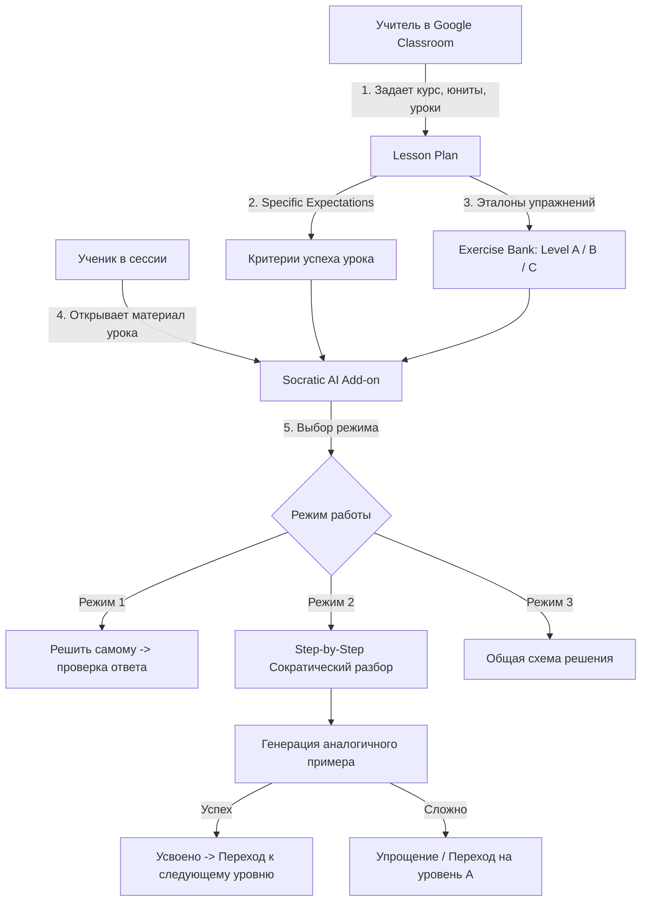

# Архитектура решения и план изменений для Socratic AI (на основе требований преподавателя)

> **Источник требований**: Аудиозапись преподавателя (`audio1376507227.m4a` / `audio1376507227_gemini.txt`).  
> **Предметная область**: Google Classroom Add-on для курсов старшей школы (пример: *Ontario Grade 12 Advanced Functions MHF4U*).  
> **Ключевой статус**: AI Teacher Assistant — персональный напарник ученика, работающий строго по сценарию и материалам учителя в его отсутствие.

---

## 1. Концепция и видение преподавателя

Преподаватель чётко формулирует роль AI:
1. **Учитель — методический директор**: Учитель заранее проектирует структуру курса, уроки, ожидания и эталонные задания.
2. **AI — доверенный ассистент на уроке**: В отсутствие учителя AI работает с учениками по учебным материалам урока.
3. **Строгий Grounding (анти-галлюцинации)**: AI не ищет произвольные материалы в интернете, а опирается исключительно на материалы урока и эталонные примеры учителя.
4. **Адаптивность (дифференцированное обучение)**: В классе из десятков учеников AI подстраивается под уровень каждого (A, B, C) прямо во время индивидуальной сессии.



---

## 2. Структура данных курса и плана урока (Lesson Plan)

В аудиозаписи описана строгая иерархия курса:

### 2.1. Иерархия курса
* **Course**: `Mathematics: Advanced Functions (MHF4U)`
* **5 Units (Юнитов)**:
  1. *Polynomial Functions*
  2. *Rational Functions*
  3. *Trigonometric Functions*
  4. *Exponential Functions*
  5. *Logarithmic Functions*
* **Unit -> Lessons**:
  - Пример для *Logarithmic Functions*:
    - *Lesson 1*: Quotient Law of Logarithms
    - *Lesson 2*: Power Law of Logarithms
    - *Lesson 3*: Product / Factor Law of Logarithms
* **Lesson Components**:
  - *Materials* (Теория, правила, формулы)
  - *Lesson Plan* (Инструкция для AI)
  - *Assignments* (Домашние и проверочные работы)

### 2.2. Модель Lesson Plan для AI

```json
{
  "courseId": "MHF4U",
  "unitId": "unit-5-logarithmic-functions",
  "lessonId": "lesson-laws-of-logarithms",
  "title": "Laws of Logarithms (Quotient, Power, Product)",
  "overallExpectations": [
    "Demonstrate an understanding of the relationships between exponential expressions and logarithmic expressions",
    "Evaluate exponential and logarithmic expressions and solve related equations"
  ],
  "specificExpectations": [
    "Know how to apply the Product Law: log_b(xy) = log_b(x) + log_b(y)",
    "Know how to apply the Quotient Law: log_b(x/y) = log_b(x) - log_b(y)",
    "Know how to apply the Power Law: log_b(x^k) = k * log_b(x)"
  ],
  "exerciseBank": {
    "topic": "Simplifying logarithmic expressions",
    "templates": {
      "levelA": {
        "difficulty": "Foundational",
        "description": "Базовые примеры на одно прямое применение правила",
        "sample": "Simplify: log_2(8) + log_2(4)",
        "rubric": "Ученик умеет сложить логарифмы с одинаковым основанием"
      },
      "levelB": {
        "difficulty": "Proficient",
        "description": "Комбинация двух правил (например, Power Law + Quotient Law)",
        "sample": "Simplify: 2 * log_3(6) - log_3(4)",
        "rubric": "Ученик сначала вносит коэффициент как степень, затем применяет частное"
      },
      "levelC": {
        "difficulty": "Advanced",
        "description": "Сложное многошаговое выражение с переменными и ограничениями ОДЗ",
        "sample": "Express as a single logarithm: 3 * log_a(x) - 1/2 * log_a(y) + 2 * log_a(z)",
        "rubric": "Полное владение всеми тремя законами с буквенными коэффициентами"
      }
    }
  }
}
```

## 3. Архитектура источников учебных материалов (Multi-Source Ingestion Pipeline)

Преподаватель не должен повторно загружать файлы вручную, если они уже есть в его экосистеме. В архитектуру закладывается **трёхканальный сбор учебных материалов (Tri-Source Ingestion)**, включающий прямую синхронизацию с лентой Google Classroom (на основе анализа скриншота ленты курса `Test Class > Math`, где уже опубликован файл `Product and Quotient... PDF`):

```
                                  ИСТОЧНИКИ УЧЕБНЫХ МАТЕРИАЛОВ
                                                │
         ┌──────────────────────────────────────┼──────────────────────────────────────┐
         ▼                                      ▼                                      ▼
[ИСТОЧНИК 1: Локальный ПК]           [ИСТОЧНИК 2: Google Диск]          [ИСТОЧНИК 3: Google Classroom]
  - Drag-and-drop с диска              - Google Drive Picker API          - Лента курса (Stream Announcements)
  - PDF, DOCX, TXT                     - Google Docs / Slides / Sheets    - Вкладка "Задания" (Classwork Materials)
  - Рукописные конспекты (OCR)         - Экспорт через Drive API          - Файлы, прикрепленные к уроку
         │                                      │                                      │
         └──────────────────────────────────────┼──────────────────────────────────────┘
                                                ▼
                               ┌───────────────────────────────────┐
                               │     Document Ingestion Engine     │
                               │  - Извлечение текста и формул     │
                               │  - Конвертация в LaTeX / Markdown │
                               │  - Привязка к Gemini File API     │
                               └─────────────────┬─────────────────┘
                                                 ▼
                               ┌───────────────────────────────────┐
                               │  Strict Grounding (Анти-галлюц.)  │
                               │  AI опирается ТОЛЬКО на документ  │
                               └───────────────────────────────────┘
```

---

### 3.1. Три источника учебных материалов

#### 1. Источник 1: Загрузка с локального компьютера (Local Upload)
* **Интерфейс учителя**: Блок Drag-and-Drop в окне настройки урока (`attachment-discovery.html`).
* **Форматы**: PDF-учебники, конспекты в `.docx`, текстовые файлы `.txt`, изображения страниц с формулами.
* **Обработка**: Файлы читаются через multipart-пайплайн сервера и передаются в модель с сохранением исходной разметки.

#### 2. Источник 2: Google Диск (Google Drive Picker & Drive API)
* **Интерфейс учителя**: Кнопка **«Выбрать из Google Диска»** открывает стандартное окно **Google Picker**.
* **Поддерживаемые типы**:
  - Файлы **Google Docs** (конспекты уроков учителя) $\rightarrow$ автоматически конвертируются в чистый Markdown через `drive.files.export(mimeType='text/plain')`.
  - Файлы **Google Slides** $\rightarrow$ извлекаются слайды с формулами и определениями.
  - PDF и книги, хранящиеся на Диске учителя.
* **Плюс**: Учителю не нужно скачивать файл на ноутбук, чтобы потом снова его загружать.

#### 3. Источник 3: Прямой импорт из ленты и заданий Google Classroom (Classroom Content Ingestion)
*(Спецификация по новому скриншоту ленты Stream курса `Test Class > Math`)*
* **Контекст в UI**: В ленте класса уже опубликован пост от `Igor RPS` с прикреплённым документом `Product and Quotient... PDF`.
* **Как работает механизм**:
  1. При открытии панели создания/настройки Socratic Add-on сервер делает запрос к Google Classroom API:
     - `classroom.courses.announcements.list`: считывает все объявления в ленте `Stream`, извлекая массив `materials[].driveFile`.
     - `classroom.courses.courseWorkMaterials.list`: считывает материалы из вкладки `Classwork`.
     - `classroom.courses.courseWork.get`: считывает файлы, уже прикрепленные к текущему заданию.
  2. В интерфейсе учителя отображается виджет:
     > 📂 **Материалы этого курса в Google Classroom:**  
     > - `[📄 Product and Quotient... (PDF из объявления Igor RPS, 9:46 AM)]` $\rightarrow$ `[Выбрать этот материал для Socratic]`  
     > - `[📄 Unit 5 Logarithms Overview (Google Doc)]` $\rightarrow$ `[Выбрать]`
  3. Учитель в 1 клик нажимает кнопку выбора $\rightarrow$ система мгновенно подтягивает `driveFileId` и использует документ как базу знаний для SocratesAI без необходимости ручной загрузки!

---

### 3.2. Обновлённая модель структуры урока (`LessonPlan` с источниками)

```json
{
  "courseId": "MHF4U",
  "unitId": "unit-5-logarithmic-functions",
  "lessonId": "lesson-laws-of-logarithms",
  "title": "Laws of Logarithms (Quotient, Power, Product)",
  "materialsSource": {
    "sourceType": "classroom_stream",
    "sourceTitle": "Product and Quotient... PDF",
    "sourceAuthor": "Igor RPS (Posted 9:46 AM)",
    "classroomAnnouncementId": "announcement-12345678",
    "driveFileId": "1a2b3c4d5e6f7g_product_and_quotient_pdf",
    "extractedTextSnippet": "Product Law: log_b(xy) = log_b(x) + log_b(y). Quotient Law: log_b(x/y) = log_b(x) - log_b(y)..."
  },
  "overallExpectations": [
    "Demonstrate an understanding of logarithmic laws and identities"
  ],
  "specificExpectations": [
    "Apply Quotient Law to simplify quotients inside logarithms",
    "Apply Power Law to simplify logarithmic exponents"
  ]
}
```

---

## 4. Архитектура диалогового взаимодействия (Student Journey)

### Шаг 1. Приветствие и привязка к уроку
AI обращается к ученику, зачитывая `specificExpectations` учителя:
> *«Привет! Учитель оставил упражнения к уроку "Laws of Logarithms". В конце урока нам важно убедиться, что ты уверенно умеешь применять Product, Quotient и Power laws. Начнём с упражнения №1.»*

### Шаг 2. Выбор режима разбора (Scaffolding Choice)
AI предлагает 3 опции взаимодействия:
1. **«Хочу решить сам»**: Ученик вводит только ответ, AI сверяет шаги, фиксирует результат.
2. **«Объясни Step-by-Step»**: Пошаговое сократическое ведение.
3. **«Дай общее решение»**: AI выдаёт общую структуру метода решения, и ученик дальше разбирается сам.

### Шаг 3. Сократический протокол Step-by-Step
- AI **не выдаёт готовый ответ**.
- AI ведёт по микро-шагам:
  - *«Шаг 1: Какое правило применимо к слагаемому $2\\log_3(6)$?»*
  - Ученик отвечает: *«Power law, шестёрка в квадрате»*.
  - AI: *«В точку! Получаем $\\log_3(36)$. Теперь Шаг 2: у нас знак минус между логарифмами. Какое правило используем дальше?»*

### Шаг 4. Адаптивная генерация аналогичного задания (Mastery Check)
После завершения эталонного упражнения:
- AI: *«Отлично, эталонное упражнение разобрали! Давай проверим усвоение: я сейчас сгенерирую аналогичный пример такого же уровня сложности, и ты решишь его самостоятельно.»*
- **Сценарий успеха**: Ученик решает верно $\rightarrow$ AI фиксирует прогресс по `specificExpectations` и переводит на следующий уровень (например, с Level A на Level B).
- **Сценарий затруднения**: Ученик ошибается $\rightarrow$ AI мягко разбирает ошибку, либо автоматически переключается на более простое задание уровня Level A.

---

## 5. Архитектура интеграции с Google Classroom и доставки ученику (Dual-Track Deployment)

На основе анализа интерфейса задания Google Classroom (`Classroom > Test Class > Math > Socratic`, см. скриншот) в архитектуру закладывается **двухканальная модель интеграции (Dual-Track)**. Это позволяет использовать Socratic прямо сейчас без сложных административных согласований, сохраняя при этом путь к официальному нативному дополнению.

```
                    ┌─────────────────────────────────────────────────────────┐
                    │               Google Classroom Assignment               │
                    │               (Задание учителя: Socratic)               │
                    └────────────────────────────┬────────────────────────────┘
                                                 │
                     ┌───────────────────────────┴───────────────────────────┐
                     ▼                                                       ▼
        [ТРЕК 1: Smart Link Attachment]                         [ТРЕК 2: Native Classroom Add-on]
   (Мгновенный запуск без прав администратора)                 (Официальный Workspace Marketplace Add-on)
                     │                                                       │
                     ▼                                                       ▼
        Учитель: "Add link" в задании                           Учитель: иконка "Add-ons" в панели
        (или Ученик: "+ Add or create -> Link")                 открывает Attachment Discovery iframe
                     │                                                       │
                     ▼                                                       ▼
        Карточка под описанием задания:                         Официальный Classroom Attachment фрейм:
        [💡 SocratesAI: Laws of Logarithms]                     [💡 SocratesAI Socratic Tutor]
                     │                                                       │
                     ▼                                                       ▼
        Вход: Google Identity Services (SSO)                    Вход: Бесшовный через addOnToken & SDK
        (ученик авторизуется Google-учеткой)                    (автоматическое распознавание studentId)
                     │                                                       │
                     └───────────────────────────┬───────────────────────────┘
                                                 ▼
                               ┌───────────────────────────────────┐
                               │     Unified Socratic Runtime      │
                               │  - Gemini 3.8 / 3.1 Flash LLM     │
                               │  - Lesson Plan & A/B/C Generator  │
                               │  - Live Telemetry & Gradebook     │
                               └───────────────────────────────────┘
```

---

### ТРЕК 1: Мгновенное интерактивное вложение (Smart Link / Web-Card Mode)
*Цель: Запуск за 20 секунд в любом Google Классе без необходимости иметь права супер-администратора школы.*

1. **Точка входа учителя**:
   - При создании или редактировании задания учитель нажимает кнопку **«🔗 Ссылка» (Add link)**.
   - Вставляет URL сгенерированного урока:  
     `https://<domain>/student-work.html?lessonId=lesson-laws-of-logarithms`
2. **Отображение у ученика на странице задания**:
   - Прямо под описанием задания (на месте строки `test` со скриншота) Google Classroom генерирует интерактивную карточку с заголовком урока, фавиконом и кнопкой перехода.
   - Альтернативно ученик в правом блоке **«Your work»** может сам нажать кнопку **«+ Add or create» $\rightarrow$ «Link»**.
3. **Авторизация ученика через Google-учётку**:
   - В интерфейс тренажёра встроена библиотека **Google Identity Services (One Tap / Sign in with Google)**.
   - При открытии карточки ученик подтверждает вход в 1 клик через свой текущий Google-аккаунт.
   - Имя, аватар и email ученика фиксируются в сессии, а результат работы сохраняется на сервере с привязкой к его профилю.
4. **Преимущества**:
   - Работает немедленно в любых школьных доменах и на личных Gmail-аккаунтах.
   - Не требует публикации в Google Workspace Marketplace и модерации Google.

---

### ТРЕК 2: Официальный нативный Google Classroom Add-on (Marketplace Add-ons API)
*Цель: Бесшовный опыт глубокой интеграции с автоматическим выставлением оценок в журнал Classroom.*

1. **Точка входа учителя**:
   - При создании задания внизу в панели прикрепления файлов (рядом с Drive, YouTube) появляется фирменная иконка **«Socratic AI»**.
   - Нажатие открывает `attachmentDiscoveryUri` во всплывающем фрейме Google Classroom: учитель выбирает Unit, Lesson и режим оценивания.
2. **Отображение у ученика на странице задания**:
   - В задание автоматически встраивается нативный блок Google Classroom Attachment.
   - При клике ученика Google Classroom открывает `attachmentStudentWorkUri` во внутреннем модальном iframe поверх Classroom (ученик вообще не покидает сайт classroom.google.com).
3. **Бесшовная авторизация и контекст**:
   - Google Classroom автоматически передаёт в URL параметры окружения:  
     `?courseId=...&itemId=...&itemType=courseWork&addOnToken=...`
   - Ученику не нужно вводить логин и пароль: система автоматически идентифицирует его через Google Classroom Add-on SDK (`window.gapi.classroom.addons`).
4. **Автоматический Grade Passback**:
   - По завершении Сократической сессии итоговый балл (например, 92/100) и отзыв отправляются напрямую в электронный журнал Google Classroom через `classroom.courses.courseWork.studentSubmissions.patch`.

---

### Сравнительная матрица двух треков интеграции

| Критерий | Трек 1: Smart Link Attachment | Трек 2: Native Classroom Add-on |
|---|---|---|
| **Скорость развёртывания** | Мгновенно (прямо сейчас) | Требует настройки Google Cloud Console |
| **Требования к правам** | Обычный учитель / ученик | Администратор домена Google Workspace |
| **Место появления в UI** | Карточка под описанием задания и/или блок "Your work" | Нативный блок Attachment в теле задания |
| **Вход ученика** | Google Sign-In в 1 клик | Полностью прозрачный через Classroom SSO Token |
| **Выставление оценки** | Экспорт отчёта учителю / ручной ввод | Автоматический Grade Passback в журнал Classroom |
| **Безопасность фрейма** | CSP `frame-ancestors https://classroom.google.com` | Полная изоляция Google Classroom Iframe |

---

## 6. Сравнение с текущей реализацией (Gap Analysis)

| Компонент | Текущее состояние в репозитории | Требуемое состояние по аудиозаписи |
|---|---|---|
| **Структура курса** | Задаётся плоским объектом в `promptEngine.js` | Иерархическая структура: Курс $\rightarrow$ Юниты (5 шт.) $\rightarrow$ Уроки $\rightarrow$ Материалы |
| **Lesson Plan** | Текстовый `learningGoal` и `targetMilestones` | Структурированный JSON с `overallExpectations`, `specificExpectations`, и банком A/B/C |
| **Источники материалов** | Только ручной ввод текста в форме | 3 источника: Локальный ПК, Google Drive, Stream/Classwork Google Classroom |
| **Выбор режима** | Студент сразу попадает в открытый чат | Стартовое меню из 3 вариантов (Самостоятельно / Step-by-Step / Общая схема) |
| **Банк уровней A/B/C** | Отсутствует | Хранилище эталонных заданий учителя 3 уровней |
| **Генератор аналогов** | Нет динамической генерации похожих задач | Модуль генерации параллельных вариантов по шаблону учителя |
| **Телеметрия сессии** | Базовый JSON в комментарии | Фиксация статуса по каждому пункту `specificExpectations` + текущий активный уровень ученика (A/B/C) |

---

## 7. Детальный план изменений для `classroom-socratic-addon`

### Фаза 1: Модели данных и курсовая структура (Backend)
1. Создать модуль `server/data/curriculum/mhf4u.json`:
   - Полная структура курса Grade 12 Advanced Functions (5 юнитов).
   - Готовый эталонный Unit 5: *Logarithmic Functions* с 3 уроками.
   - Банк шаблонов задач уровня A, B, C для каждого урока.
2. Создать контроллер `lessonPlanService.js`:
   - Получение плана урока по `courseId` и `lessonId`.
   - Валидация наличия `specificExpectations` и эталонов A/B/C.
3. Добавить сервис сбора материалов `server/services/materialIngestionService.js`:
   - Получение файлов из Google Drive API и Google Classroom API (лента Stream & Classwork).

### Фаза 2: Обновление Socratic Prompt Engine (`server/services/promptEngine.js`)
1. Добавить генерацию специализированных промптов:
   - `buildLessonScaffoldPrompt(...)`: Включает `specificExpectations`, уровень сложности (A/B/C), текущий режим диалога.
   - `buildSimilarExercisePrompt(...)`: Инструкция для генерации строго параллельного математического примера на основе шаблона учителя без выхода за рамки темы.
   - `buildStepByStepGuidancePrompt(...)`: Контроль пошагового ведения без раскрытия итогового ответа.
2. Добавить обработку выбора режима ученика (Solo, Step-by-Step, Blueprint).

### Фаза 3: Интерактивный интерфейс ученика (`public/student-work.html`, `public/js/studentApp.js`)
1. **Экран запуска урока**:
   - Отображение темы урока, целей (`Specific Expectations`) и карточек выбора режима:
     - 🚀 *Решить самому и проверить ответ*
     - 🪜 *Пошаговый интерактивный разбор (Step-by-Step)*
     - 🗺️ *Общая карта решения для самостоятельной работы*
2. **Индикатор прогресса по уровням**:
   - Бейджи уровней: `Level A (Базовый)`, `Level B (Стандартный)`, `Level C (Продвинутый)`.
   - Прогресс-бар выполнения `specificExpectations` учителя.
3. **Кнопка "Проверить себя на аналогичном задании"**:
   - Запуск генератора похожих задач прямо из диалога.

### Фаза 4: Панель учителя (`public/teacher-review.html` и `public/attachment-discovery.html`)
1. **Редактор Lesson Plan и выбор материалов**:
   - Выбор источника: «Загрузить файл» / «Выбрать из Google Диска» / «Выбрать из ленты этого курса Google Classroom».
   - Учитель вводит Overall и Specific expectations.
   - Ввод 3 примеров (A, B, C) — AI показывает превью, какие задачи он сможет генерировать.
2. **Аналитика сессий класса**:
   - Сводная матрица: какой ученик на каком уровне (A, B или C) остановился, какие `specificExpectations` освоены, а где потребовалось упрощение.

---

## 8. Пример диалогового сценария (End-to-End Walkthrough)

1. **Ученик открывает Add-on в Google Classroom**:
   > **AI**: «Привет, Алекс! Сегодня на уроке **Quotient & Power Laws of Logarithms** нам нужно научиться применять законы логарифмов к выражениям. Учитель подготовил для тебя задание. Как начнём?»  
   > `[Решу сам]` `[Объясни по шагам]` `[Дай общую схему]`

2. **Ученик выбирает `[Объясни по шагам]`**:
   > **AI**: «Отлично, идём шаг за шагом! Вот задание уровня B:  
   > Simplify: $$2\\log_3(6) - \\log_3(4)$$  
   > С чего начнём? Посмотри на первое слагаемое $2\\log_3(6)$. Какое правило позволяет перенести множитель 2?»

3. **Ответ ученика**: «Power rule, двойка уходит в степень шестерки».
   > **AI**: «Именно! Получаем $\\log_3(6^2) = \\log_3(36)$.  
   > Теперь выражение выглядит так: $$\\log_3(36) - \\log_3(4)$$  
   > Какой следующий шаг подсказывает знак минус?»

4. **Завершение разбора и проверка усвоения**:
   > **Ученик**: «Деление! $36 / 4 = 9$, получается $\\log_3(9) = 2$».  
   > **AI**: «Блестяще! Ответ: 2. Теперь проверим, закрепился ли навык. Я сгенерировал аналогичное задание:  
   > $$3\\log_2(4) - \\log_2(8)$$  
   > Попробуй решить его полностью самостоятельно и напиши итоговый ответ.»

5. **Фиксация в Google Classroom Gradebook**:
   В журнал отправляется оценка и детализированный отчёт:
   - *Mastery Level*: 85% (Level B mastered).
   - *Expectations Met*: Power Law ($\checkmark$), Quotient Law ($\checkmark$).
   - *Independence*: Решил проверочный аналог без дополнительных подсказок.

---

## 9. Следующие шаги реализации

1. [ ] Добавить файл конфигурации учебного плана `server/data/curriculum/mhf4u.json` с 5 юнитами и примерами A/B/C.
2. [ ] Обновить `server/services/promptEngine.js` под логику 3 режимов и генерации аналогичных задач.
3. [ ] Модернизировать веб-интерфейс ученика (`public/student-work.html`) для поддержки карточек выбора режима и индикатора A/B/C.
4. [ ] Протестировать сквозной сценарий через Google Classroom Add-on Simulator.
